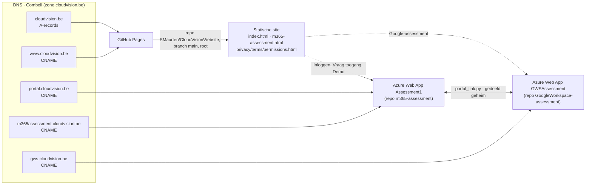
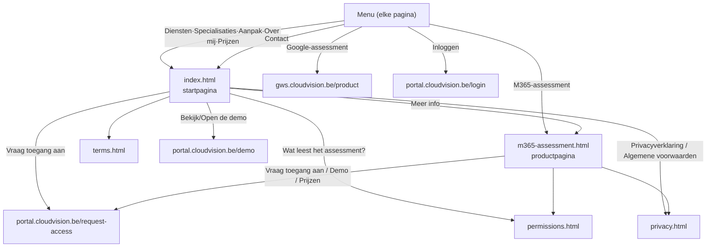
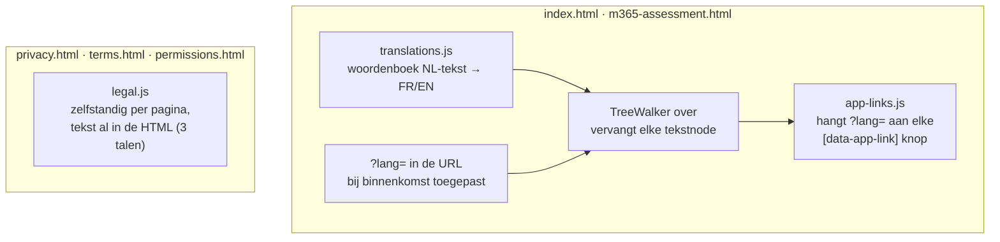

# Setup — CloudVisionWebsite

De configuratie van de website zelf en van wat eromheen staat (hosting, DNS, beveiliging). De portalen
(`m365-assessment` en `GoogleWorkspace-assessment`) hebben hun eigen repo en eigen `setup.md`/`docs/`; hier staat
enkel hoe de website naar hen verwijst.

## 1. Overzicht



De website zelf is **statisch**: geen server, geen build, geen framework. GitHub Pages serveert de bestanden
rechtstreeks uit de root van `main`. De twee portalen zijn aparte Azure-apps; de website linkt er alleen naartoe.

## 2. Hosting en domeinen

| Domein | Wijst naar | Via |
|---|---|---|
| `www.cloudvision.be` | `smaarten.github.io` | CNAME (Combell) |
| `cloudvision.be` (apex) | `185.199.108/109/110/111.153` | A-records naar GitHub Pages |
| `portal.cloudvision.be`, `m365assessment.cloudvision.be` | Azure Web App `Assessment1` | CNAME — zie repo `m365-assessment` |
| `gws.cloudvision.be` | Azure Web App `GWSAssessment` | CNAME — zie repo `GoogleWorkspace-assessment` |

- **GitHub Pages**: repo `SMaarten/CloudVisionWebsite`, bron = branch `main`, pad `/` (root). `CNAME`-bestand in de
  repo bevat `www.cloudvision.be`; GitHub stuurt de apex automatisch door naar `www`.
- **HTTPS**: afgedwongen (`https_enforced`), certificaat door GitHub beheerd, geldig tot 2026-12-31, dekt zowel
  `cloudvision.be` als `www.cloudvision.be`.
- **Geen CI/CD-workflow** in deze repo: een push/merge naar `main` publiceert meteen. De portaal-repo's gebruiken
  wél GitHub Actions (tests + container image) vóór een herstart — dat staat in hun eigen repo.
- **Mergewijze**: deze repo gebruikt, net als de portalen, **Rebase and merge**. Een PR met een eigen merge-commit
  (bv. een lokale `git merge` van twee feature branches) kan niet gerebaset worden — zet zo'n branch dan om naar
  rechtlijnige commits vóór je de PR opent (zie git-geschiedenis van PR's #6 vs #7 voor een voorbeeld).

## 3. Bestandenoverzicht

```
CloudVisionWebsite/
├── index.html                startpagina (NL, met ?lang= voor FR/EN)
├── m365-assessment.html      productpagina M365-assessment
├── index-alternative.html    ongebruikte alternatieve kleurstelling — niet gelinkt, wél publiek bereikbaar
├── privacy.html              privacyverklaring (NL/FR/EN in één bestand)
├── terms.html                algemene voorwaarden
├── permissions.html          "Wat leest het assessment?"
├── site.css                  gedeelde stijlen: index.html + m365-assessment.html
├── legal.css                 gedeelde stijlen: privacy/terms/permissions
├── translations.js           vertaalmotor voor index.html + m365-assessment.html
├── legal.js                  eigen, eenvoudiger taalwissel voor de juridische pagina's
├── app-links.js              hangt ?lang= aan elke [data-app-link] (knoppen naar de portalen)
├── fonts/                    zelf-gehoste .ttf's + fonts.css (Bricolage Grotesque, Figtree, JetBrains Mono)
├── CNAME                     www.cloudvision.be (GitHub Pages custom domain)
└── CloudVisionWebsite.code-workspace
```

**Pagina's en hun knoppenbestemmingen** (wat intern blijft, wat naar een portaal gaat):



## 4. Beveiliging

Elke HTML-pagina zet dezelfde twee meta-tags (GitHub Pages laat geen echte HTTP-headers toe, dus dit loopt via
`<meta http-equiv>`):

```
Content-Security-Policy: default-src 'self'; script-src 'self'; style-src 'self' 'unsafe-inline';
  img-src 'self' data:; font-src 'self'; connect-src 'self'; object-src 'none'; base-uri 'self';
  form-action 'none'; upgrade-insecure-requests
Referrer-Policy: strict-origin-when-cross-origin
```

- Geen externe scripts, lettertypes of stylesheets (alles self-hosted) — vandaar `script-src 'self'` zonder
  uitzonderingen.
- `form-action 'none'`: de website zelf heeft geen `<form>`; alle acties zijn links (`<a>`) naar de portalen.
- `img-src` staat `data:` toe voor de inline SVG-iconen/illustraties.

## 5. Theming

Kleuren zijn CSS-variabelen op `:root` in `site.css` / `legal.css`. Er is **geen handmatige lichte/donkere
schakelaar**: donker volgt automatisch `prefers-color-scheme: dark` van het besturingssysteem. De selectors
`:root[data-theme="dark"]` en `:root:not([data-theme="light"])` bestaan in de CSS maar worden door niets gezet —
dat zijn voorbereidingen voor een toggle die er nog niet is.

`site.css` bevat na de basistokens een tweede `:root`-blok dat de "warme" kleurstelling (zandkleurig/okertinten in
plaats van fel kobaltblauw) overschrijft — dat blok is in de praktijk altijd actief op `index.html` en
`m365-assessment.html`. `index-alternative.html` laadt `site.css` niet en toont daarom nog de originele
kobaltblauwe tokens.

## 6. Meertaligheid

Twee aparte, onafhankelijke systemen:



- **`translations.js`**: het Nederlandse origineel staat gewoon in de HTML; het woordenboek (`fr: {...}`, `en:
  {...}`) vertaalt elke tekstnode bij taalwissel. Een nieuwe pagina die dit systeem gebruikt, moet elke eigen
  tekst aan beide woordenboeken toevoegen (zie `missing_tr.py`-aanpak uit eerdere PR's om ontbrekende teksten op
  te sporen).
- **`legal.js`**: de drie talen staan alle drie al in de HTML van `privacy.html`/`terms.html`/`permissions.html`;
  het script toont/verbergt enkel het juiste blok. Eenvoudiger, maar niet herbruikbaar voor nieuwe pagina's zonder
  die structuur over te nemen.
- **Taal die meegaat tussen pagina's**: een link met `data-app-link` (naar een portaal) krijgt `?lang=` via
  `app-links.js`. Een link naar een andere eigen pagina (bv. `m365-assessment.html`) draagt de taal **niet**
  automatisch over, behalve wanneer hij ook `data-app-link` heeft — die pagina's lezen dan zelf `?lang=` uit de URL
  bij het laden.

## 7. Responsief gedrag

- Mobiel-breed: één kolom, menu's en prijskaarten stapelen (`@media (max-width:560px)`/`820px`/`900px`, per
  sectie verschillend).
- **Tussen 1140px en 1240px**: menulinks krijgen minder ruimte (kleinere letters/gap) zodat alles op één lijn blijft.
- **Onder 1140px**: de menulinks (Diensten…Prijzen, M365-assessment, Google-assessment) verdwijnen volledig; enkel
  logo, taalkiezer, Inloggen en Contact blijven. Er is **geen hamburgermenu** — op die breedtes (bv. een tablet in
  liggende stand net onder 1140px) zijn M365-assessment en Google-assessment niet via het menu bereikbaar, enkel
  via knoppen verderop op de pagina (Meer info / Google-assessment heeft daar geen alternatieve knop).

## 8. Bekende aandachtspunten

- `index-alternative.html` staat live op `https://www.cloudvision.be/index-alternative.html` maar wordt nergens
  naartoe gelinkt. Bewust gehouden als vergelijkingspagina; niet opnemen in een sitemap als die er ooit komt.
- Geen hamburgermenu onder 1140px (zie §7) — Google-assessment is op die breedtes alleen bereikbaar door naar
  `gws.cloudvision.be/product` te surfen, niet via de website zelf.
- Geen `robots.txt` of sitemap in deze repo.
- `translations.js` en `legal.js` delen niets: een tekst die op beide soorten pagina's voorkomt (bv.
  "Privacyverklaring") moet apart vertaald worden in beide systemen.

## 9. Een wijziging uitrollen

1. Branch, wijzigen, PR naar `main` (Rebase and merge — zie §2).
2. Na de merge publiceert GitHub Pages automatisch; geen herstart, geen build om op te wachten. Controleer met
   `curl -s -o /dev/null -w '%{http_code}' https://www.cloudvision.be/<pad>` of de nieuwe versie online staat
   (GitHub Pages cachet soms een minuut).
3. Een link naar een portaal pas je hier aan; het gedrag van die knop (bv. `/request-access`, `/demo`) hoort thuis
   in de repo van dat portaal.
